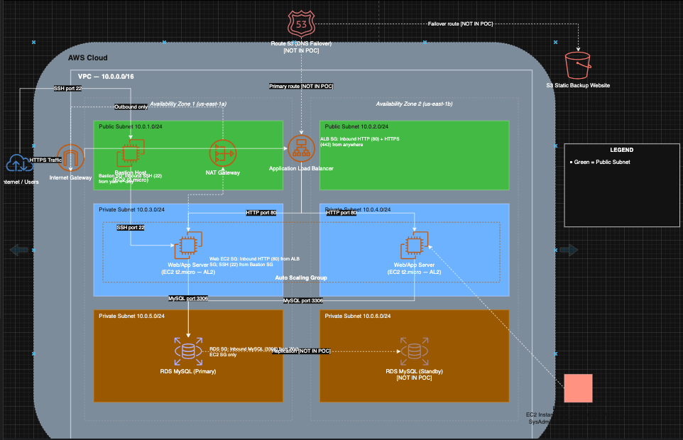
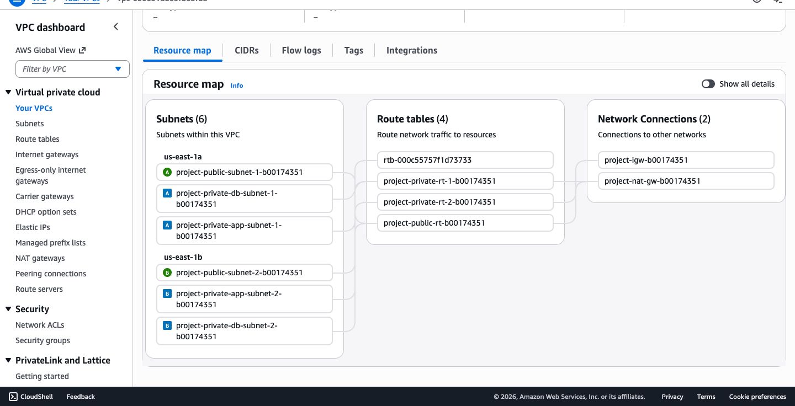
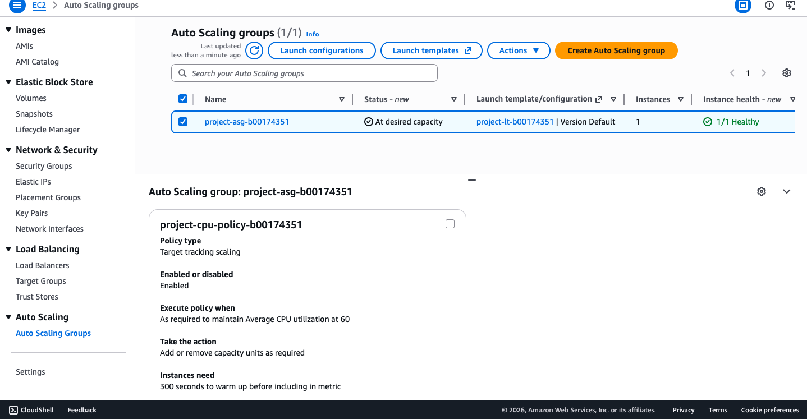
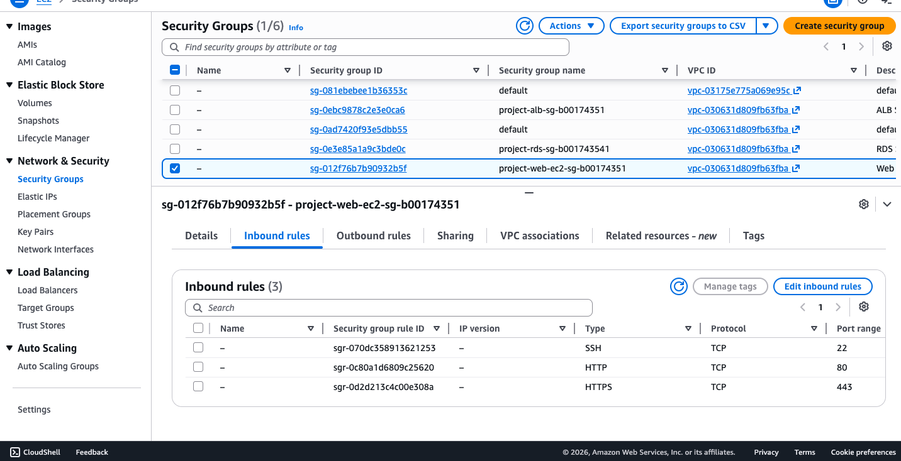

# Secure, Scalable AWS Cloud Proof of Concept (Three-Tier Architecture)

Design and hands-on build of a secure, highly available AWS architecture for **WinLocal Giveaways**, a fictional Dublin start-up whose on-premises setup suffered downtime, uncontrolled database growth, fixed capacity and a ransomware infection that went unnoticed for ten weeks because the network was flat.

**Module:** Security Architecture (COMP H2701), TU Dublin, individual project (submitted May 2026)
**Author:** Benjamin Oludipe
**Tools / services:** AWS VPC, EC2, AMI + Launch Template, Auto Scaling, Application Load Balancer, RDS MySQL, S3 static hosting, Security Groups, CloudWatch, draw.io; frameworks: NIST CSF 2.0, AWS Well-Architected (Sustainability pillar)

---

## What I built
A three-tier architecture in one VPC across **two Availability Zones** (us-east-1a / 1b), built within a **$50 budget** and validated in the AWS console:

| Tier | Components | Purpose |
|---|---|---|
| Public | Application Load Balancer, Bastion Host, NAT Gateway, Internet Gateway | Only the ALB (HTTP/HTTPS) and the bastion (SSH from one admin address) face the internet |
| Application (private) | EC2 web servers in an **Auto Scaling Group** (min 1 / max 2) built from a custom AMI | No public IPs; administered only through the bastion (jump host) |
| Database (private) | **RDS MySQL** (db.t3.micro, 20 GiB) in a dedicated DB subnet group | Reachable only on port 3306 from the web tier |
| Failover | S3 static website | Maintenance page if every application tier is down |

Six /24 subnets (2 public, 2 app, 2 database) with separate public and private route tables.

## Security design (defence in depth)
- **Network segmentation** fixes the root cause of the ransomware incident: web servers and the database have no internet exposure.
- **Four security groups, least privilege, chained by group not by IP:** internet → ALB (80/443) → web tier (80) → database (3306); SSH only bastion → web. Referencing security groups instead of IPs keeps rules valid when instances scale, and an attacker who compromises one tier cannot jump past the next.
- **Recommended additions (designed, outside the PoC budget):** AWS WAF in front of the ALB (OWASP Top 10 managed rules plus request logging, closing the gap that hid the original breach) and Route 53 failover to the S3 site.
- **NIST CSF 2.0 mapping:** the design greatly improves *Protect*; *Detect* and *Govern* are flagged as the next areas to mature.

## Testing and results
- **Auto scaling:** the Linux `stress` tool (2 CPU workers, 300 seconds) pushed CPU past the **60% target-tracking threshold**; CloudWatch went into ALARM and the ASG launched a second instance, then scaled back in when load dropped.
- **Load balancing:** repeated requests to the ALB endpoint were served by different instances; health checks removed unhealthy instances automatically.
- **Database:** the web application connected to the RDS endpoint and displayed data from the database.
- **Failover page:** the S3 static site was confirmed reachable through its website endpoint.

## My contribution
Individual project: I designed the target architecture (diagram), built and configured every component of the proof of concept in the AWS console, ran the scaling, load-balancing and connectivity tests, and wrote the report, including the extra security services, the sustainability review and the NIST CSF 2.0 mapping.

## Evidence
| | |
|---|---|
|  |  |
| Target-state architecture (draw.io) | VPC resource map: 6 subnets across 2 AZs, route tables, IGW and NAT |
|  |  |
| Auto Scaling Group with target-tracking CPU policy | Web-tier security group: HTTP from the ALB group, SSH from the bastion group |

Console screenshots are cropped to remove account details. The lab environment has since been shut down. The full report is available on request.

## What it demonstrates
Secure cloud architecture, network segmentation and least-privilege access control, high availability and auto scaling, mapping a design to NIST CSF 2.0, and cost- and sustainability-aware engineering.
